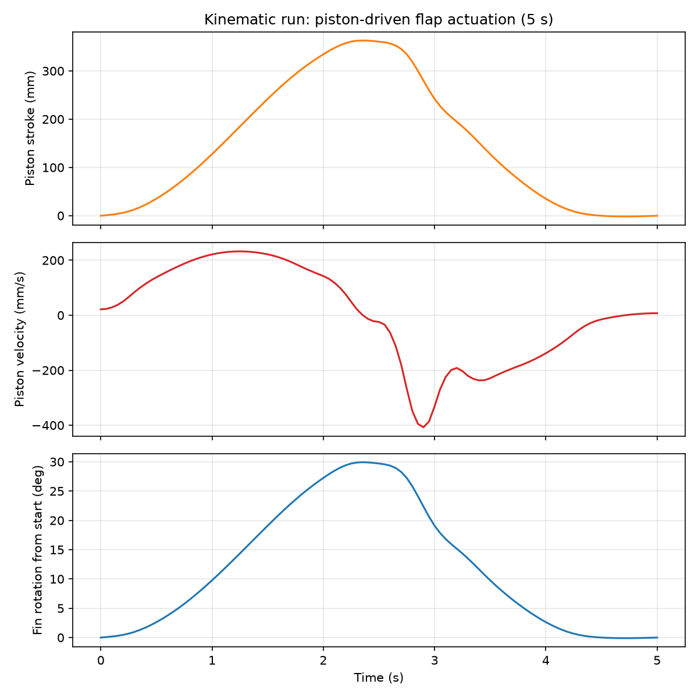
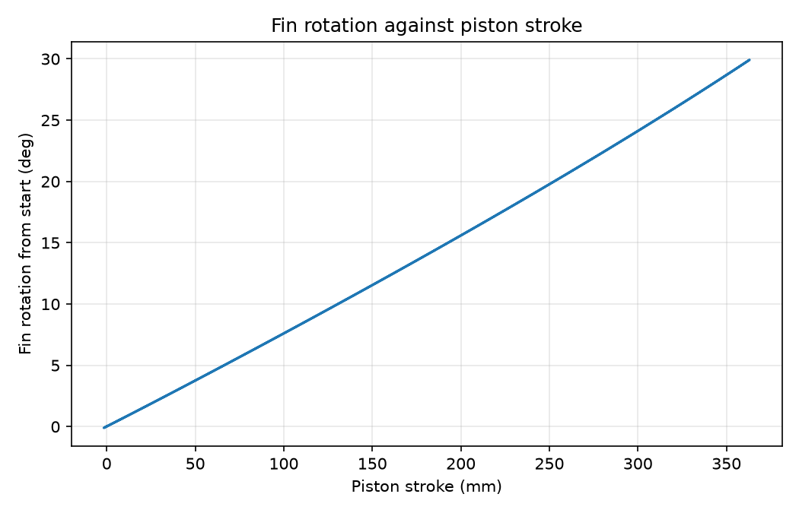
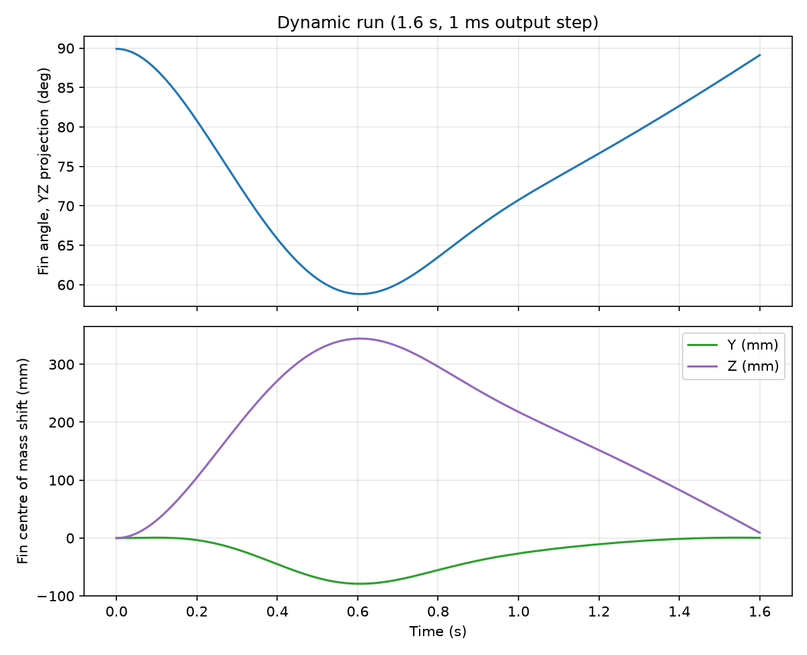

# Project Expansion

Multibody simulation of a piston-driven pitch actuation mechanism for a full-scale
hexagonal grid fin (aspect ratio 12, the fin from my M.Tech CFD thesis), designed in CATIA
and simulated in 3DEXPERIENCE CATIA Motion Design (Simpack solver). The model covers one
fin station.

## Mechanism

A slider-crank linkage on a bracket fixed to the rocket body:

- **Bracket** (fixed to the rocket body) carries the piston housing and the fin hinge shaft.
- **Piston** slides in the housing along its axis; this is the driven stroke.
- **Piston push link** joins the piston pin to the fin.
- **Fin** pivots on the bracket hinge shaft.

| Joint | Bodies | Type | Constraints |
|---|---|---|---|
| Fix.1 | rocket body | Fix | 6 |
| Rigid.10 | bracket - rocket body | Rigid | 6 |
| Prismatic.2 | bracket - piston | Prismatic (driven stroke) | 5 |
| Revolute.11 | bracket - fin | Revolute (hinge) | 5 |
| Universal.9 | piston - piston push | Universal | 4 |
| Spherical.12 | piston push - fin | Spherical | 3 |

The three moving bodies (piston, link, fin) have 18 degrees of freedom; the joints remove 17,
leaving one, which the joint driver on Prismatic.2 controls. A universal joint at one end of
the link and a spherical joint at the other keep the closed loop free of redundant
constraints (two universal joints locked the same direction twice and the solver failed
to find consistent positions).

## Results

All values below are read from the exported sensor data in
[`grid-fin-deployment/simulation/results/`](grid-fin-deployment/simulation/results/) by
[`plot_station_results.py`](grid-fin-deployment/scripts/plot_station_results.py); the summary
is in [`summary.txt`](grid-fin-deployment/simulation/plots/summary.txt).

### Kinematic run (piston-driven, 5 s)

The piston is driven out and back by a Data Points function.

- Piston stroke: 0 to 363 mm and back.
- Fin rotation: 30.0 degrees over the stroke, returning to the start position.
- Peak piston speed: 0.23 m/s extending, 0.41 m/s retracting.
- Fin rotation is close to linear in piston stroke (about 0.083 degrees per mm).

### Force-driven dynamic run (1.6 s, 1 ms output step)

A duplicate of the mechanism with the joint driver removed: the piston is moved by an
applied force on the Prismatic.2 joint instead of a prescribed motion, so the fin motion
follows from the force and the inertia of the Ti-6Al-4V parts.

| Model input (assumed value) | On | Value |
|---|---|---|
| Actuator force, pushes the piston out, then reverses to pull it back | Prismatic.2, Translation Z | ±37.5 kN |
| Viscous damper (flow restriction in the actuator) | Prismatic.2, Translation Z | 1.5 × 10⁵ N·s/m |

An angle probe and a centre-of-mass sensor on the fin record its response:

- Fin angle (YZ projection) goes from 89.9 to 58.8 degrees at 0.61 s and returns to 89.1 degrees at 1.6 s.
- The fin centre of mass shifts by up to 344 mm in Z and 79 mm in Y during the swing.

### Mass properties (Ti-6Al-4V, 4430 kg/m³)

Volumes are from the CATIA measure; masses are volume × 4430 kg/m³.

| Body | Volume (cm³) | Mass (kg) |
|---|---|---|
| Fin | 5053.7 | 22.39 |
| Piston push link | 191.9 | 0.85 |
| Piston | 99.3 | 0.44 |

The exported [`mass_properties_measure.csv`](grid-fin-deployment/simulation/results/mass_properties_measure.csv)
was taken before the material was assigned and uses the default density of 7770 kg/m³, so
its mass column is not the Ti-6Al-4V value; its volumes, centres of gravity and principal
axes are unaffected.

## Files

| Path | Content |
|---|---|
| [`flap_pitch_actuation_kinematic.3dxml`](grid-fin-deployment/simulation/3dxml/) | Assembly and mechanism, kinematic model |
| [`flap_pitch_actuation_dynamic.3dxml`](grid-fin-deployment/simulation/3dxml/) | Assembly with Ti-6Al-4V and the force-driven run animation |
| [`simulation/results/`](grid-fin-deployment/simulation/results/) | Sensor exports (CSV) from the 3DEXPERIENCE 2D plots, and the mass properties measure |
| [`simulation/plots/`](grid-fin-deployment/simulation/plots/) | Plots and value summary generated from the CSVs |
| [`scripts/`](grid-fin-deployment/scripts/) | Python post-processing |

### Opening the 3DXML files

3DXML is Dassault Systèmes' lightweight 3D format. Free ways to open it:

- [3D XML Player](https://www.3ds.com/products/catia/3d-xml) (Windows, free from Dassault Systèmes)
- [Innerscene 3DXML viewer](https://www.innerscene.com/tools/3dxml-viewer), in the browser, no install
- [GLC_Player](https://glc-player.net/) (Windows, macOS, Linux)

## Tools

CATIA (part and assembly design), CATIA Motion Design on 3DEXPERIENCE with the Simpack
solver, Python (matplotlib) for post-processing.
