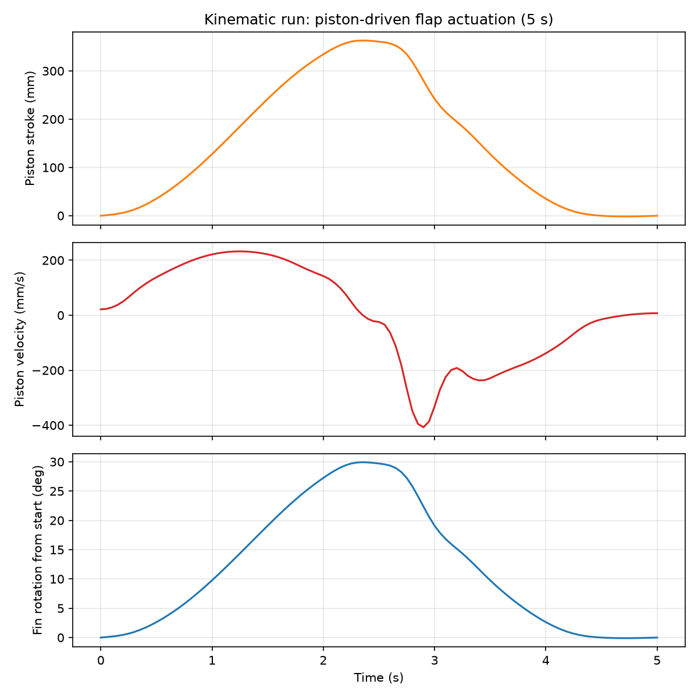
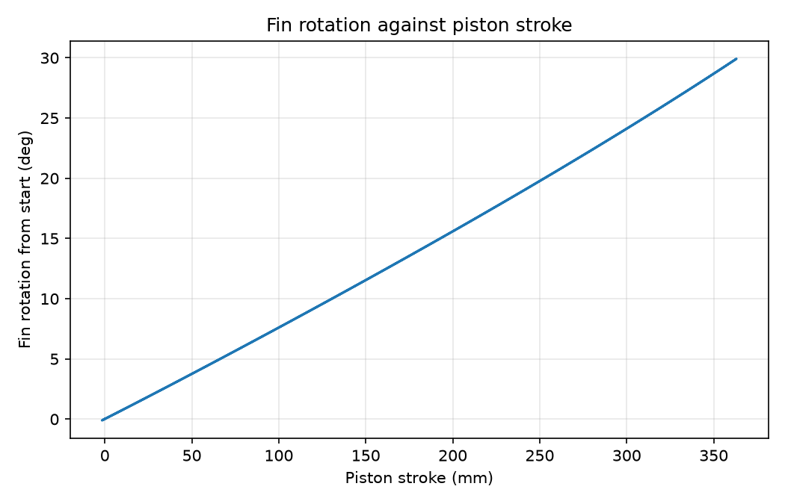
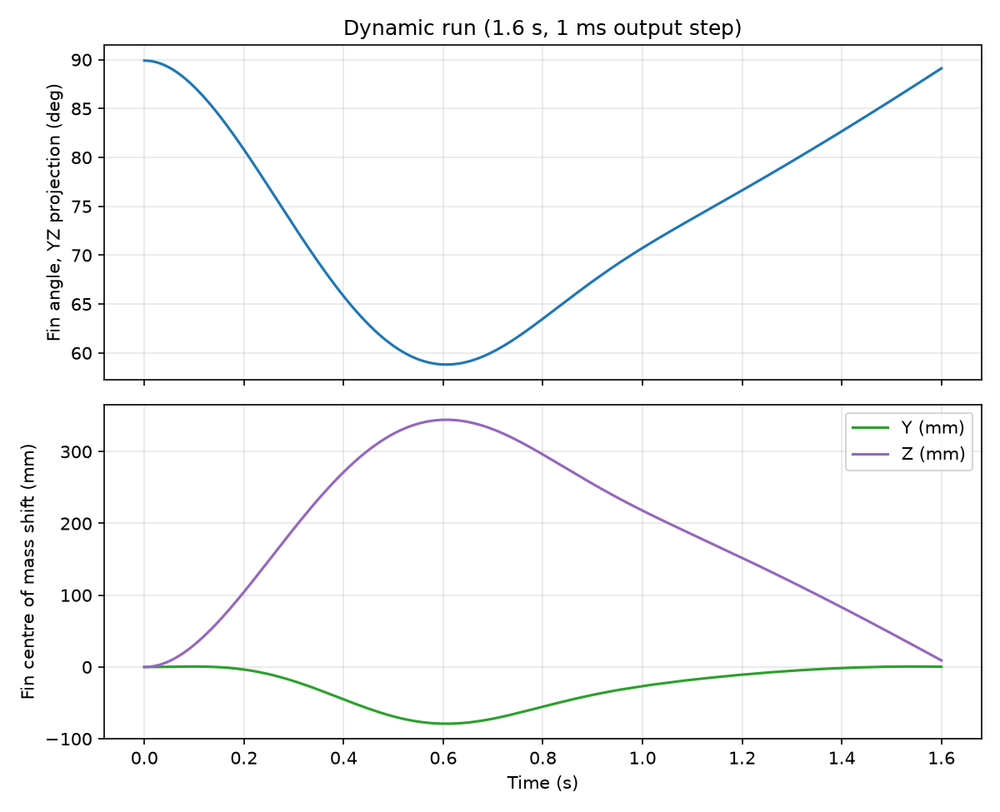

# Grid Fin Flap Actuation: Multibody Simulation in 3DEXPERIENCE

A full-scale hexagonal grid fin (aspect ratio 12, from my M.Tech CFD thesis) with a
piston-driven pitch actuation mechanism, designed in CATIA and simulated in
3DEXPERIENCE CATIA Motion Design (Simpack solver). The model covers one fin station.

## Mechanism

A slider-crank linkage on a bracket fixed to the rocket body:

- **Bracket** (fixed to the rocket body) carries the piston housing and the fin hinge shaft.
- **Piston** slides in the housing along its axis; this is the driven stroke.
- **Piston push link** joins the piston pin to the fin.
- **Fin** pivots on the bracket hinge shaft.

| Joint | Bodies | Type | Constraints |
|---|---|---|---|
| Fix.1 | rocket body | Fix | 6 |
| Rigid.10 | bracket - rocket body | Rigid | 6 |
| Prismatic.2 | bracket - piston | Prismatic (driven stroke) | 5 |
| Revolute.11 | bracket - fin | Revolute (hinge) | 5 |
| Universal.9 | piston - piston push | Universal | 4 |
| Spherical.12 | piston push - fin | Spherical | 3 |

The three moving bodies (piston, link, fin) have 18 degrees of freedom; the joints remove 17,
leaving one, which the joint driver on Prismatic.2 controls. A universal joint at one end of
the link and a spherical joint at the other keep the closed loop free of redundant
constraints (two universal joints locked the same direction twice and the solver failed
to find consistent positions).

## Results

All values below are read from the exported sensor data in [`simulation/results/`](simulation/results/)
by [`scripts/plot_station_results.py`](scripts/plot_station_results.py); the summary is in
[`simulation/plots/summary.txt`](simulation/plots/summary.txt).

### Kinematic run (piston-driven, 5 s)

The piston is driven out and back by a Data Points function.

- Piston stroke: 0 to 363 mm and back.
- Fin rotation: 30.0 degrees over the stroke, returning to the start position.
- Peak piston speed: 0.23 m/s extending, 0.41 m/s retracting.
- Fin rotation is close to linear in piston stroke (about 0.083 degrees per mm).

### Dynamic run (1.6 s, 1 ms output step)

Dynamic analysis of the same mechanism with Ti-6Al-4V material applied. An angle probe
and a centre-of-mass sensor on the fin record its response:

- Fin angle (YZ projection) goes from 89.9 to 58.8 degrees at 0.61 s and returns to 89.1 degrees at 1.6 s.
- The fin centre of mass shifts by up to 344 mm in Z and 79 mm in Y during the swing.

## Files

| Path | Content |
|---|---|
| [`simulation/3dxml/flap_pitch_actuation_kinematic.3dxml`](simulation/3dxml/) | Assembly and mechanism, kinematic model |
| [`simulation/3dxml/flap_pitch_actuation_dynamic.3dxml`](simulation/3dxml/) | Assembly with material and the dynamic run animation |
| [`simulation/results/`](simulation/results/) | Sensor exports (CSV) from the 3DEXPERIENCE 2D plots, and the mass properties measure |
| [`simulation/plots/`](simulation/plots/) | Plots and value summary generated from the CSVs |
| [`scripts/`](scripts/) | Python post-processing |
| [`cad/`](cad/) | Early concept sketches, renders and drawings made before the CATIA model (superseded concept, kept for the design history) |
| [`model/`](model/) | Design notes and parameter tables from the concept phase |

### Opening the 3DXML files

3DXML is Dassault Systèmes' lightweight 3D format. Free ways to open it:

- [3D XML Player](https://www.3ds.com/products/catia/3d-xml) (Windows, free from Dassault Systèmes)
- [Innerscene 3DXML viewer](https://www.innerscene.com/tools/3dxml-viewer), in the browser, no install
- [GLC_Player](https://glc-player.net/) (Windows, macOS, Linux)

## Tools

CATIA (part and assembly design), CATIA Motion Design on 3DEXPERIENCE with the Simpack
solver, Python (matplotlib) for post-processing.

## Next steps

- Gravity and joint reaction forces (piston force, hinge load) with a hand-calculation check.
- Force-driven deployment with an end stop, for deployment time and impact load.
- Aerodynamic hinge moment from the thesis CFD data.
- Flexible link from an Abaqus modal reduction.

Geometry is my own design, built for this portfolio; no customer or company data is used.
